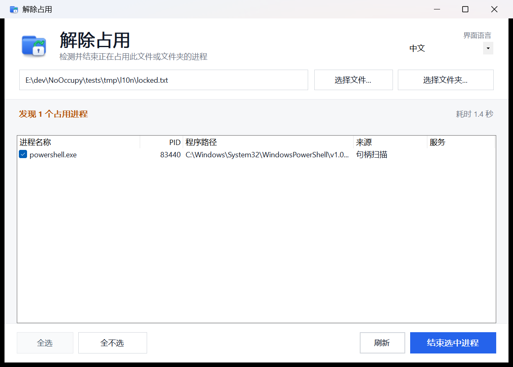
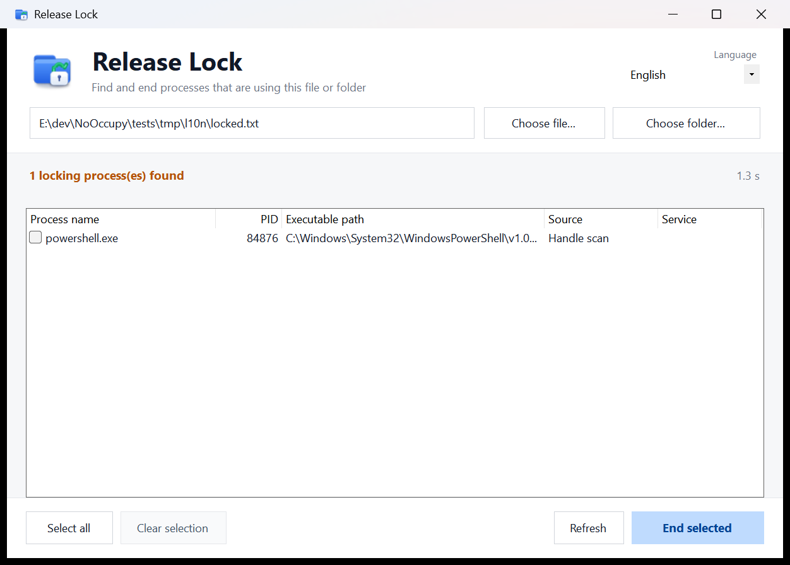
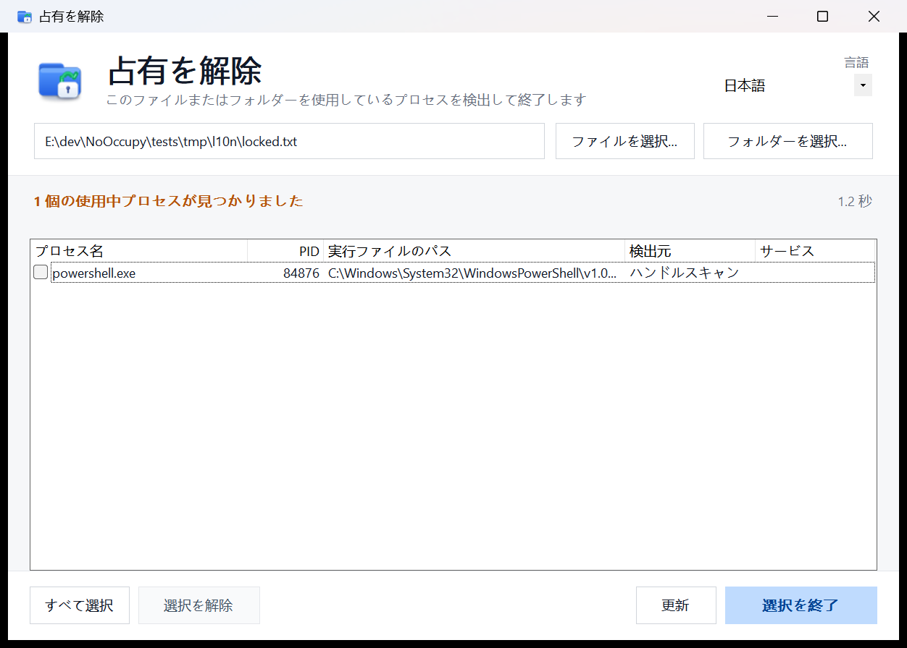
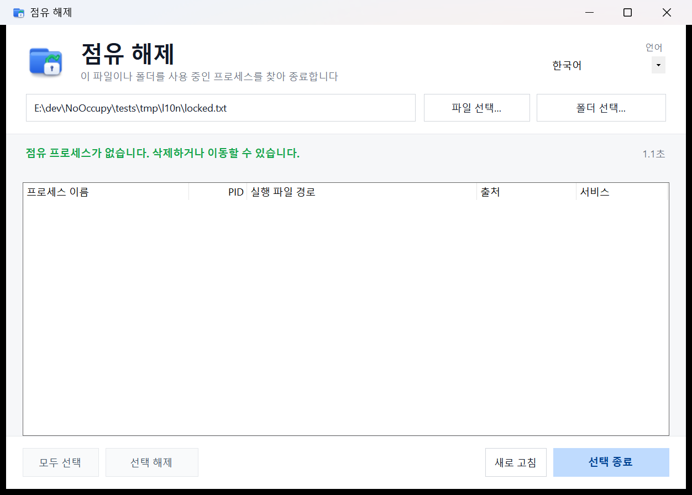
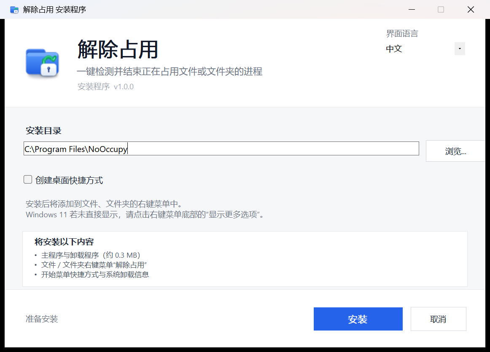

<div align="center">


# NoOccupy · 解除占用

### 找到占用进程，让文件操作继续。

**一个轻量的 Windows 工具：查找并结束占用文件或文件夹的进程，随后重试删除、移动或重命名。**

[](https://github.com/yuan-xin-9997/NoOccupy/releases/latest)
[](#下载安装)
[](#界面语言)
[](https://github.com/yuan-xin-9997/NoOccupy/releases/latest/download/NoOccupy-Setup.exe)
[](https://nooccupy.yuan-xin.top/)

[English](README.md) | 简体中文 | [更新日志](CHANGELOG.md)

**[下载](#下载安装) · [功能特性](#功能特性) · [激活与购买](#激活与购买) · [常见问题](#常见问题) · [支持](#支持)**

</div>

> **关于本仓库**
>
> 本仓库用于发布 NoOccupy 官方安装包和用户文档；源代码维护在私有仓库中。请从 [Releases](https://github.com/yuan-xin-9997/NoOccupy/releases/latest) 下载安装包，或在 [销售网站](https://nooccupy.yuan-xin.top/) 购买激活码。

## 项目介绍

“操作无法完成，因为文件已在另一个程序中打开。”遇到这个提示时，NoOccupy 可以帮你找到对应进程，省去在任务管理器里逐个排查的过程。

右键点击文件或文件夹，选择 **解除占用**，查看并勾选占用进程，确认结束后，再次尝试删除、移动或重命名。

对于迅雷等会自动重启下载组件的软件，解除占用时会同时结束同一应用目录中的父进程，并在确认框列出这些进程。结束后会重新扫描；仍有占用或扫描警告时不会提示完全成功。此操作会中断对应应用的下载和其他未保存任务。

## 界面预览

<div align="center">

</div>

<details>
<summary>查看其他语言界面和安装器</summary>

| English | 日本語 |
| :---: | :---: |
|  |  |

| 한국어 | 安装器 |
| :---: | :---: |
|  |  |

</details>

## 功能特性

| 功能 | 说明 |
| --- | --- |
| 资源管理器集成 | 支持文件、文件夹和文件夹空白处的右键菜单。 |
| 多种检测方式 | 结合 Windows Restart Manager、NT 句柄扫描和模块路径扫描。 |
| 文件夹递归检测 | 分批扫描内部文件，跳过符号链接和联接点，避免循环遍历。 |
| 清晰的进程信息 | 展示进程名称、PID、程序路径、检测来源和服务。 |
| 按需结束进程 | 支持单选、多选和全选，结束前确认；标记并跳过已知关键进程。 |
| 四语言支持 | 主程序、安装器、激活窗口和确认对话框均支持中文、英文、日文、韩文。 |
| 轻量运行 | 单文件安装包约 0.3 MB，无后台服务。 |
| 离线激活 | 从 v1.1.0 开始支持与本机绑定的离线激活码；激活和日常使用均不访问授权服务器。 |
| 自动化接口 | 提供命令行扫描与结束进程功能，支持 JSON 输出和退出码。 |

## 下载安装

| 下载内容 | 说明 |
| --- | --- |
| **[NoOccupy-Setup.exe](https://github.com/yuan-xin-9997/NoOccupy/releases/latest/download/NoOccupy-Setup.exe)** | 推荐：Windows 单文件安装包。 |
| [全部版本](https://github.com/yuan-xin-9997/NoOccupy/releases) | 查看版本历史、发布说明及旧版安装包。 |
| [SHA256SUMS.txt](https://github.com/yuan-xin-9997/NoOccupy/releases/latest/download/SHA256SUMS.txt) | 最新安装包的 SHA-256 校验值。 |
| **[购买激活码](https://nooccupy.yuan-xin.top/)** | 在销售网站购买激活码。 |

**系统要求：** Windows 10 / Windows 11（64 位）、.NET Framework 4.8 或更高版本，以及管理员权限。

1. 下载并运行 `NoOccupy-Setup.exe`。
2. 在 Windows 管理员权限提示中选择允许。
3. 选择界面语言和安装目录，默认目录为 `C:\Program Files\NoOccupy`。
4. 点击 **安装**。安装器会添加资源管理器右键菜单、开始菜单快捷方式和系统卸载项。
5. 启动 NoOccupy。如果当前版本需要激活，输入收到的激活码。

桌面快捷方式默认不创建，可以在安装界面中勾选。

<details>
<summary>静默安装与下载校验</summary>

在管理员 PowerShell 中执行安装命令：

```powershell
.\NoOccupy-Setup.exe /S
.\NoOccupy-Setup.exe /S /D="D:\Tools\NoOccupy"
```

将以下命令输出与同一 Release 的 `SHA256SUMS.txt` 比较：

```powershell
Get-FileHash .\NoOccupy-Setup.exe -Algorithm SHA256
```

</details>

## 激活与购买

NoOccupy v1.1.0 开始支持 **离线激活**：

- 首次启动时，激活窗口会显示形如 `A1B2-C3D4-E5F6-G7H8` 的机器码。
- 在 [销售网站](https://nooccupy.yuan-xin.top/) 购买激活码，并按页面提示提交机器码。
- 把收到的激活码粘贴到软件中，点击 **激活**。
- 激活由内嵌公钥离线验证，不访问授权服务器。

激活窗口和主界面都提供购买入口。没有激活码时，点击激活窗口中的 **购买激活码**，或访问 [销售网站](https://nooccupy.yuan-xin.top/)。

> v1.0.2 仍是当前最新稳定版；v1.1.0 激活版会在验证完成后以预发布形式发布。请以 [Releases](https://github.com/yuan-xin-9997/NoOccupy/releases) 页面为准。

## 快速上手

1. 右键点击被占用的文件或文件夹，选择 **解除占用**。
2. 查看检测到的进程，勾选需要结束的项目。
3. 点击 **结束选中进程**，在确认框中确认。
4. 重新尝试删除、移动或重命名文件或文件夹。

也可以从开始菜单打开程序，点击 **选择文件…** 或 **选择文件夹…** 指定目标。

> **Windows 11：** 请先点击右键菜单底部的 **显示更多选项**，或按 **Shift + F10** 打开传统右键菜单。

> 结束进程可能丢失该进程尚未保存的工作，请先保存并核对勾选项。受系统保护的进程可能无法结束，程序会显示失败原因。

## 界面语言

| 语言 | 右键菜单名称 | 系统卸载列表名称 |
| --- | --- | --- |
| English | Release Lock | Release Lock (NoOccupy) |
| 简体中文 | 解除占用 | 解除占用 (NoOccupy) |
| 日本語 | 占有を解除 | 占有を解除 (NoOccupy) |
| 한국어 | 점유 해제 | 점유 해제 (NoOccupy) |

在安装器顶部或主程序右上角的 **界面语言** 菜单中选择语言。界面、对话框、右键菜单和系统卸载列表名称会立即更新。

## 常见问题

### Windows 11 右键菜单中为什么找不到入口？

NoOccupy 注册的是资源管理器传统右键菜单。Windows 11 将此类入口放在 **显示更多选项** 中，Windows 10 则会直接显示。

### 为什么需要管理员权限？

检测其他进程持有的句柄、结束进程、注册系统级右键菜单以及保存整机激活信息需要提升权限。主程序和安装器启动时都会申请管理员权限。

### 如何激活？

启动程序后，如果出现激活窗口，复制机器码并发给销售方，或直接在 [销售网站](https://nooccupy.yuan-xin.top/) 购买。收到激活码后粘贴并点击 **激活**。验证完全离线。

### 激活需要联网吗？

不需要。激活码由内嵌公钥离线验证，可以在完全离线的电脑上激活。

### 会常驻后台或上传文件吗？

程序不发起网络请求，不安装后台服务，打开时扫描，关闭即退出。激活由内嵌公钥离线验证，不连接授权服务器。语言偏好保存在注册表中，激活信息保存在 `%ProgramData%\NoOccupy`，诊断日志可能写入 Windows 临时目录。

### 如何卸载？

打开 **Windows 设置 → 应用 → 已安装的应用**，找到上表中当前语言对应的名称，点击 **卸载**。也可使用控制面板，或运行安装目录中的 `NoOccupyUninstall.exe`。

卸载会移除程序目录、右键菜单、开始菜单快捷方式和系统卸载项。激活信息默认保留在 `%ProgramData%\NoOccupy`，同一台机器重装后无需重新激活。需要彻底清除时，可在卸载前运行：

```powershell
& "C:\Program Files\NoOccupy\NoOccupy.exe" --deactivate
```

## 支持

- 销售网站与激活码：<https://nooccupy.yuan-xin.top/>
- 支持邮箱：<yuanxin9997@163.com>
- 问题反馈：在本仓库提交 Issue。

## 更新日志

见 [CHANGELOG.md](CHANGELOG.md)。

---

NoOccupy 为商业软件，当前条款和隐私政策请见销售网站。
