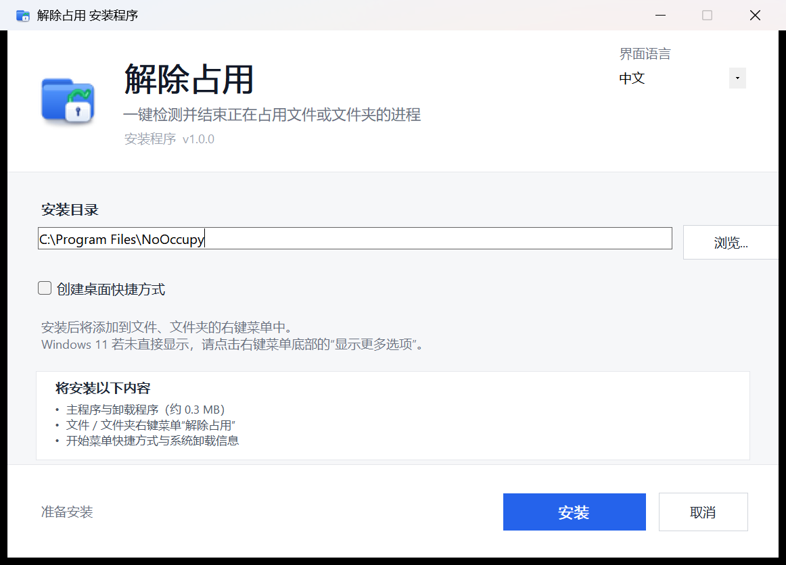

<div align="center">


# NoOccupy · 解除占用

### 找到占用进程，让文件操作继续。

**一个轻量的 Windows 工具：查找并结束占用文件或文件夹的进程，随后重试删除、移动或重命名。**

[](https://github.com/yuan-xin-9997/NoOccupy/releases/latest)
[](#下载安装)
[](#开发构建)
[](#界面语言)
[](https://github.com/yuan-xin-9997/NoOccupy/releases/latest/download/NoOccupy-Setup.exe)

[English](README.md) | 简体中文 | [更新日志](CHANGELOG.md)

**[下载](#下载安装) · [快速上手](#快速上手) · [功能特性](#功能特性) · [常见问题](#常见问题) · [开发构建](#开发构建)**

</div>

## 项目介绍

“操作无法完成，因为文件已在另一个程序中打开。”遇到这个提示时，NoOccupy 可以帮你找到对应进程，省去在任务管理器里逐个排查的过程。

右键点击文件或文件夹，选择 **解除占用**，查看并勾选占用进程，确认结束后，再次尝试删除、移动或重命名。

## 界面预览

<div align="center">

</div>

<details>
<summary>查看安装器和其他语言界面</summary>

| 安装器 | English |
| :---: | :---: |
|  |  |

| 日本語 | 한국어 |
| :---: | :---: |
|  |  |

</details>

## 功能特性

| 功能 | 说明 |
| --- | --- |
| 资源管理器集成 | 支持文件、文件夹和文件夹空白处的右键菜单。 |
| 多种检测方式 | 结合 Windows Restart Manager、NT 句柄扫描和模块路径扫描。 |
| 文件夹递归检测 | 分批扫描内部文件，跳过符号链接和联接点，避免循环遍历。 |
| 清晰的进程信息 | 展示进程名称、PID、程序路径、检测来源和服务。 |
| 按需结束进程 | 支持单选、多选和全选，结束前确认；标记并跳过已知关键进程。 |
| 四语言支持 | 主程序、安装器和确认对话框均支持中文、英文、日文、韩文。 |
| 轻量运行 | 单文件安装包约 234 KB，无后台服务，不发起网络请求。 |
| 自动化接口 | 提供命令行扫描与结束进程功能，支持 JSON 输出和退出码。 |

## 下载安装

### Windows

| 下载内容 | 说明 |
| --- | --- |
| **[NoOccupy-Setup.exe](https://github.com/yuan-xin-9997/NoOccupy/releases/latest/download/NoOccupy-Setup.exe)** | 推荐：Windows 单文件安装包。 |
| [全部版本](https://github.com/yuan-xin-9997/NoOccupy/releases) | 查看版本历史、发布说明及旧版安装包。 |
| [SHA256SUMS.txt](https://github.com/yuan-xin-9997/NoOccupy/releases/latest/download/SHA256SUMS.txt) | 最新安装包的 SHA-256 校验值。 |

**系统要求：** Windows 10 / Windows 11（64 位）、.NET Framework 4.8 或更高版本，以及管理员权限。

1. 下载并运行 `NoOccupy-Setup.exe`。
2. 在 Windows 管理员权限提示中选择允许。
3. 选择界面语言和安装目录，默认目录为 `C:\Program Files\NoOccupy`。
4. 点击 **安装**。安装器会添加资源管理器右键菜单、开始菜单快捷方式和系统卸载项。

桌面快捷方式默认不创建，可以在安装界面中勾选。

<details>
<summary>静默安装与下载校验</summary>

在管理员 PowerShell 中执行安装命令：

```powershell
.\NoOccupy-Setup.exe /S
.\NoOccupy-Setup.exe /S /D="D:\Tools\NoOccupy"
```

将以下命令输出与同一 Release 的 `SHA256SUMS.txt` 比较：

```powershell
Get-FileHash .\NoOccupy-Setup.exe -Algorithm SHA256
```

</details>

## 快速上手

1. 右键点击被占用的文件或文件夹，选择 **解除占用**。
2. 查看检测到的进程，勾选需要结束的项目。
3. 点击 **结束选中进程**，在确认框中确认。
4. 重新尝试删除、移动或重命名文件或文件夹。

也可以从开始菜单打开程序，点击 **选择文件…** 或 **选择文件夹…** 指定目标。

> **Windows 11：** 请先点击右键菜单底部的 **显示更多选项**，或按 **Shift + F10** 打开传统右键菜单。

> 结束进程可能丢失该进程尚未保存的工作，请先保存并核对勾选项。受系统保护的进程可能无法结束，程序会显示失败原因。

## 界面语言

| 语言 | 右键菜单 / 开始菜单名称 | 系统卸载列表名称 |
| --- | --- | --- |
| English | Release Lock | Release Lock (NoOccupy) |
| 简体中文 | 解除占用 | 解除占用 (NoOccupy) |
| 日本語 | 占有を解除 | 占有を解除 (NoOccupy) |
| 한국어 | 점유 해제 | 점유 해제 (NoOccupy) |

在安装器顶部或主程序右上角的 **界面语言** 菜单中选择语言。界面、对话框和已安装的右键菜单会立即更新。

语言保存在 `HKCU\Software\NoOccupy\Language`，主程序与安装器共用。首次启动会自动识别中文、日文和韩文系统，其他系统语言使用英文。命令行输出保持中文，便于现有脚本兼容。

## 常见问题

### Windows 11 右键菜单中为什么找不到入口？

NoOccupy 注册的是资源管理器传统右键菜单。Windows 11 将此类入口放在 **显示更多选项** 中，Windows 10 则会直接显示。

### 为什么需要管理员权限？

检测其他进程持有的句柄、结束进程和注册系统级右键菜单需要提升权限。主程序和安装器启动时都会申请管理员权限。

### 是否一定能找到并解除所有占用？

受保护进程、无法访问的句柄或句柄查询超时都可能影响检测与结束操作，程序会显示警告或错误。递归扫描会跳过符号链接和联接点；需要检查链接目标时，请直接选择目标路径。

### 会常驻后台或上传文件吗？

程序不发起网络请求，不安装后台服务，打开时扫描，关闭即退出。语言偏好保存在注册表中，诊断日志可能写入 Windows 临时目录。

### 如何卸载？

打开 **Windows 设置 → 应用 → 已安装的应用**，找到上表中当前语言对应的名称，点击 **卸载**。也可使用控制面板，或运行安装目录中的 `NoOccupyUninstall.exe`。

管理员 PowerShell 静默卸载：

```powershell
& "C:\Program Files\NoOccupy\NoOccupyUninstall.exe" /S /uninstall
```

卸载会移除程序目录、右键菜单、开始菜单快捷方式和系统卸载项。

## 命令行

在管理员 PowerShell 中进入安装目录后执行：

```powershell
.\NoOccupy.exe --scan "C:\path\to\file" --json --out result.json
.\NoOccupy.exe --kill "C:\path\to\file" --all --json
.\NoOccupy.exe --kill "C:\path\to\file" --pid 1234,5678
.\NoOccupy.exe --version
.\NoOccupy.exe --help
```

退出码：`0` 成功，`1` 参数、扫描或输出错误，`2` 一个或多个进程结束失败。命令行结束进程时不弹出图形确认框；`--pid` 可以指定扫描结果之外的进程，执行前请核对 PID。

## 开发构建

在 Windows 上使用 **.NET SDK 8** 构建。未安装 Developer Pack 时，SDK 可以通过 NuGet 恢复 .NET Framework 4.8 引用程序集。

```powershell
git clone https://github.com/yuan-xin-9997/NoOccupy.git
cd NoOccupy
powershell -NoProfile -ExecutionPolicy Bypass -File .\scripts\build.ps1
powershell -NoProfile -ExecutionPolicy Bypass -File .\scripts\test-release.ps1
```

构建产物为 `dist/NoOccupy-Setup.exe` 和 `dist/SHA256SUMS.txt`，安装包同时复制到仓库根目录。发布检查会验证程序集版本、安装器内嵌文件及校验值，不执行安装操作。

<details>
<summary>目录结构</summary>

```text
src/NoOccupy/           WinForms 主程序与命令行接口
  Core/                Restart Manager、句柄/模块扫描、结束进程
src/NoOccupy.Setup/     内嵌主程序的单文件安装器
src/Shared/            语言偏好与本地化对话框
assets/                应用图标
scripts/               构建与发布验证
tests/                 验收脚本、截图和报告
docs/                  设计与发布文档
Directory.Build.props  主程序与安装器共用版本号
.github/workflows/     tag 触发的自动发布流程
```

</details>

发布新版本时，更新 `Directory.Build.props` 和更新日志，再推送匹配的 `vX.Y.Z` 标签。GitHub Actions 会自动构建、验证，并将 `.exe` 和校验文件上传到 Release。具体操作见 [发布指南](docs/RELEASING.md)。

## 参与贡献

欢迎 [报告问题](https://github.com/yuan-xin-9997/NoOccupy/issues) 或提交 Pull Request。请附上 Windows 版本、软件版本、界面语言、复现步骤和错误提示。

涉及扫描引擎或安装器的改动，请附上相关验证结果。已有验收记录见 [核心测试报告](tests/core-report.md) 和 [安装与四语言测试报告](tests/setup-report.md)。

## 致谢

README 组织方式参考了 [CC Switch](https://github.com/farion1231/cc-switch)。
