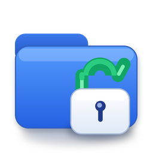
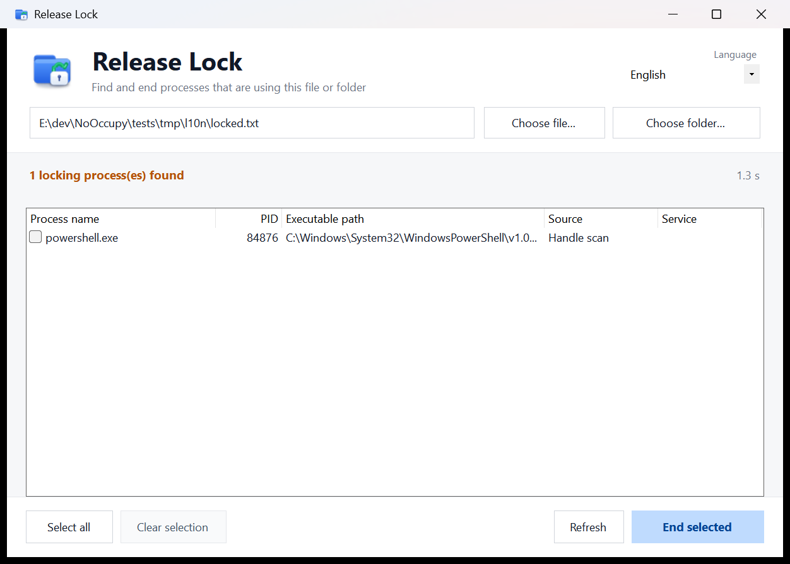
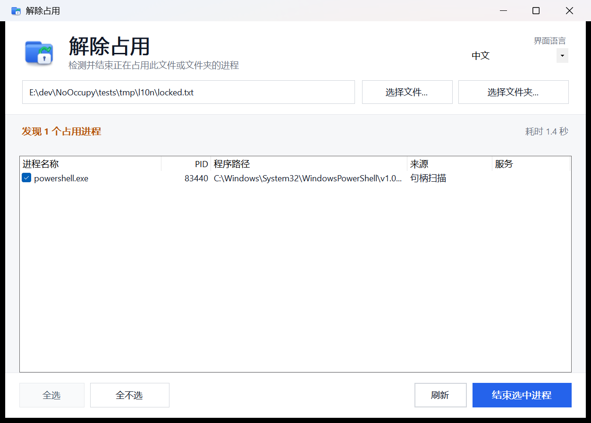
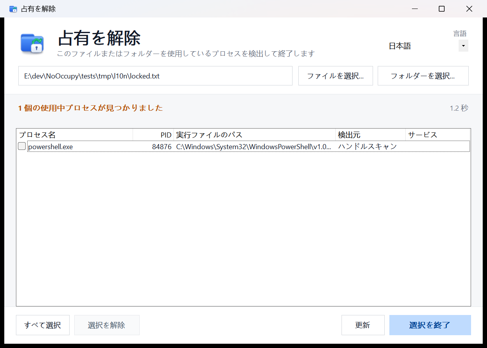
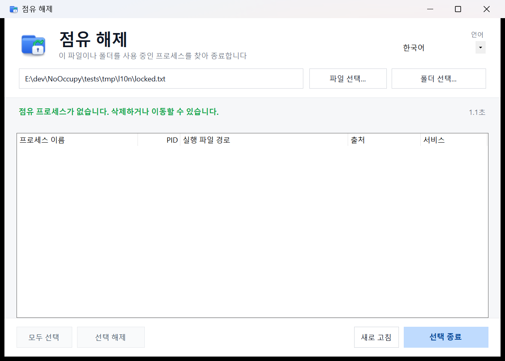
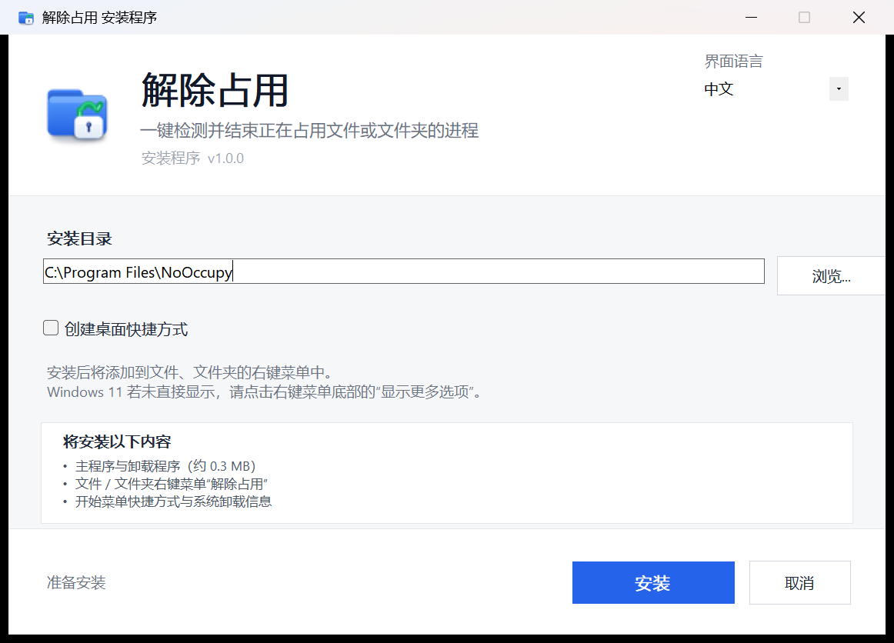

<div align="center">



# NoOccupy

### Find what's locking your files. Get back to work.

**A lightweight Windows utility to find and end processes that prevent files or folders from being deleted, moved, or renamed.**

[](https://github.com/yuan-xin-9997/NoOccupy/releases/latest)
[](#download--installation)
[](#languages)
[](https://github.com/yuan-xin-9997/NoOccupy/releases/latest/download/NoOccupy-Setup.exe)
[](https://nooccupy.yuan-xin.top/)

English | [简体中文](README.cn.md) | [Changelog](CHANGELOG.md)

**[Download](#download--installation) · [Features](#features) · [Activation](#activation--purchase) · [FAQ](#faq) · [Support](#support)**

</div>

> **About this repository**
>
> This is the official release and documentation repository for NoOccupy. The source code is maintained in a private repository. Download the installer from [Releases](https://github.com/yuan-xin-9997/NoOccupy/releases/latest) or buy an activation code from the [store](https://nooccupy.yuan-xin.top/).

## Overview

“The action can't be completed because the file is open in another program.” NoOccupy helps you find that program without searching through Task Manager.

Right-click a file or folder, choose **Release Lock**, review the processes, and end the ones you select. Then retry your delete, move, or rename operation.

For helpers that are automatically restarted, NoOccupy also ends parent processes in the same application directory and lists them in the confirmation dialog. It rechecks locks before reporting the result. This can interrupt downloads and unsaved work in that application.

## Screenshots

<div align="center">

</div>

<details>
<summary>Other interface languages and installer</summary>

| 简体中文 | 日本語 |
| :---: | :---: |
|  |  |

| 한국어 | Installer |
| :---: | :---: |
|  |  |

</details>

## Features

| Feature | What you get |
| --- | --- |
| Explorer integration | Open from the context menu for files, folders, or a folder background. |
| Multiple detection methods | Combine Windows Restart Manager, NT handle scanning, and module path scanning. |
| Folder scanning | Scan files recursively in batches; skip symbolic links and junctions to avoid loops. |
| Clear process details | Review process names, PIDs, executable paths, detection sources, and services. |
| Selective termination | Select individual processes or all results, then confirm before ending them. Known critical processes are marked and skipped. |
| Four interface languages | Switch the app, installer, and dialogs between English, Chinese, Japanese, and Korean. |
| Small footprint | A single installer of about 0.3 MB, with no background service or licensing server. |
| Offline activation | Starting with v1.1.0, activate once with a machine-bound code; no network request is made during activation or normal use. |
| Automation | Scan and terminate processes through a CLI with JSON output and exit codes. |

## Download & Installation

| Download | Description |
| --- | --- |
| **[NoOccupy-Setup.exe](https://github.com/yuan-xin-9997/NoOccupy/releases/latest/download/NoOccupy-Setup.exe)** | Recommended: single-file Windows installer. |
| [All releases](https://github.com/yuan-xin-9997/NoOccupy/releases) | Version history, release notes, and earlier installers. |
| [SHA256SUMS.txt](https://github.com/yuan-xin-9997/NoOccupy/releases/latest/download/SHA256SUMS.txt) | SHA-256 checksum for the latest installer. |
| **[Buy activation code](https://nooccupy.yuan-xin.top/)** | Purchase an activation code from the store. |

**Requirements:** Windows 10 or Windows 11 (64-bit), .NET Framework 4.8 or later, and administrator permission.

1. Download and run `NoOccupy-Setup.exe`.
2. Allow the Windows administrator prompt.
3. Select your language and install folder. The default is `C:\Program Files\NoOccupy`.
4. Click **Install**. The installer adds Explorer menus, a Start menu shortcut, and a Windows uninstall entry.
5. Start NoOccupy. If your version requires activation, enter the code you received.

A desktop shortcut is optional and disabled by default.

<details>
<summary>Silent installation and checksum verification</summary>

Run installation commands from an elevated PowerShell window:

```powershell
.\NoOccupy-Setup.exe /S
.\NoOccupy-Setup.exe /S /D="D:\Tools\NoOccupy"
```

Compare the following hash with `SHA256SUMS.txt` from the same release:

```powershell
Get-FileHash .\NoOccupy-Setup.exe -Algorithm SHA256
```

</details>

## Activation & Purchase

NoOccupy v1.1.0 introduces **offline activation**:

- On first launch, the activation window shows a **machine code** such as `A1B2-C3D4-E5F6-G7H8`.
- Buy an activation code from the [store](https://nooccupy.yuan-xin.top/), then submit the machine code as instructed.
- Paste the activation code into the app and click **Activate**.
- Activation is verified offline with an embedded public key. No licensing server is contacted.

The activation window and the main window both include a purchase entry. If you do not have a code, click **Buy activation code** in the activation window or visit the [store](https://nooccupy.yuan-xin.top/).

> v1.0.2 remains the latest stable release. The v1.1.0 activation build will be published as a pre-release after validation. Check the [Releases](https://github.com/yuan-xin-9997/NoOccupy/releases) page for the current build.

## Quick Start

1. Right-click the locked file or folder and choose **Release Lock**.
2. Review the detected processes and select the ones you want to end.
3. Click **End selected** and confirm.
4. Retry deleting, moving, or renaming the file or folder.

You can also open NoOccupy from the Start menu and use **Choose file…** or **Choose folder…**.

> **Windows 11:** click **Show more options** to find the Explorer menu entry, or press **Shift + F10** to open the classic menu.

> Ending a process can discard its unsaved work. Save your work and review your selection before confirming. Protected processes may remain locked; NoOccupy reports failures.

## Languages

| Language | Explorer menu name | Windows uninstall entry |
| --- | --- | --- |
| English | Release Lock | Release Lock (NoOccupy) |
| 简体中文 | 解除占用 | 解除占用 (NoOccupy) |
| 日本語 | 占有を解除 | 占有を解除 (NoOccupy) |
| 한국어 | 점유 해제 | 점유 해제 (NoOccupy) |

Choose a language at the top of the installer or in the app's upper-right **Language** menu. The interface, dialogs, Explorer menu names, and Windows uninstall entry update immediately.

## FAQ

### Why isn't the menu visible on Windows 11?

NoOccupy registers a classic Explorer menu. Windows 11 places these entries under **Show more options**. Windows 10 shows the entry directly.

### Why does it request administrator permission?

Detecting handles owned by other processes, ending processes, registering system-wide Explorer menus, and saving machine-wide activation information require elevated permission. Both the app and installer request it at startup.

### How do I activate NoOccupy?

Start the app. If the activation window appears, copy the machine code and send it to the seller, or buy a code from the [store](https://nooccupy.yuan-xin.top/). Paste the activation code and click **Activate**. Activation is verified offline.

### Does activation require an internet connection?

No. The activation code is verified with a public key embedded in the app. You can activate on an offline computer.

### Does it run in the background or upload my files?

NoOccupy makes no network requests and installs no background service. It scans when opened and exits when closed. Activation is verified offline; no licensing server is contacted. Language preferences are stored in the registry; activation information is stored in `%ProgramData%\NoOccupy`; diagnostic logs may be written to the Windows temporary folder.

### How do I uninstall it?

Use **Windows Settings → Apps → Installed apps**, find the localized name above, and choose **Uninstall**. You can also use Control Panel or run `NoOccupyUninstall.exe` in the install folder.

Uninstall removes the program folder, Explorer menus, Start menu shortcut, and uninstall entry. The activation file in `%ProgramData%\NoOccupy` is kept by default so a reinstall on the same computer does not need reactivation. Run `NoOccupy.exe --deactivate` before uninstalling if you want to remove it.

## Support

- Store and activation codes: <https://nooccupy.yuan-xin.top/>
- Support email: <yuanxin9997@163.com>
- Report a problem: open an issue in this repository.

## Changelog

See [CHANGELOG.md](CHANGELOG.md) for release notes.

---

NoOccupy is proprietary software. See the store for the current terms and privacy policy.
