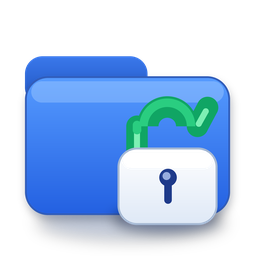
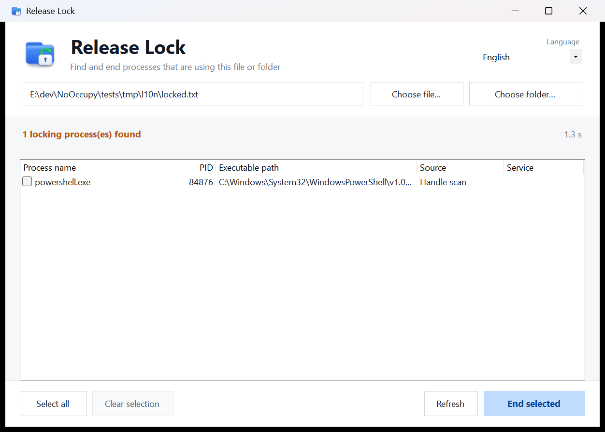
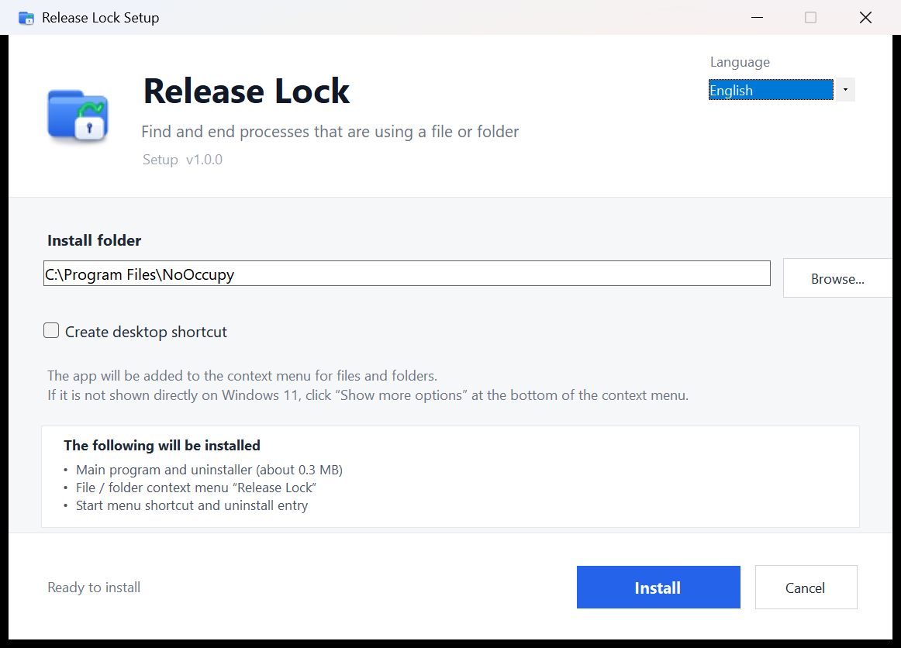
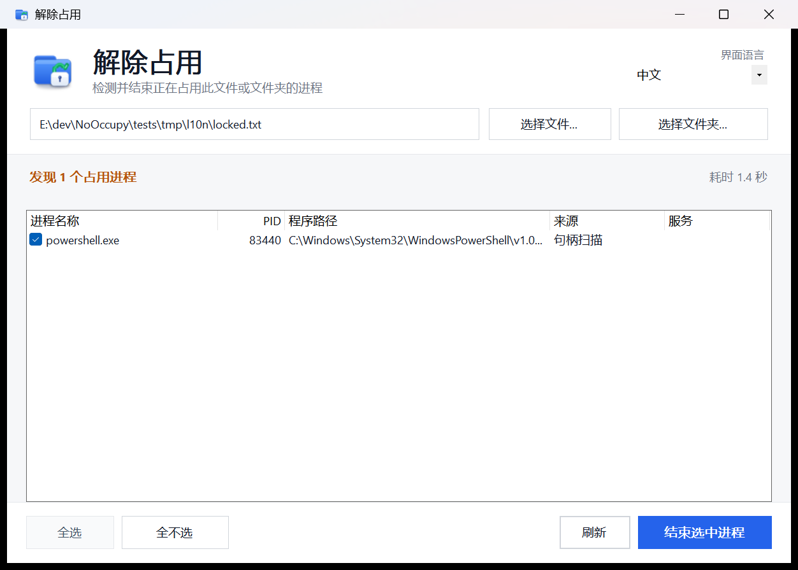
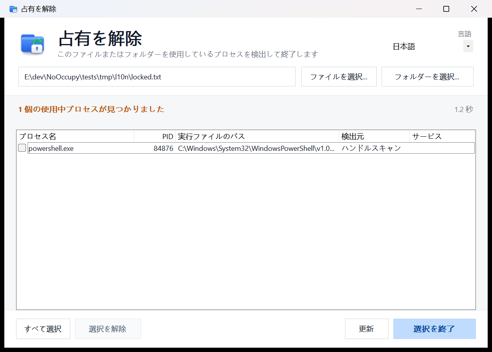
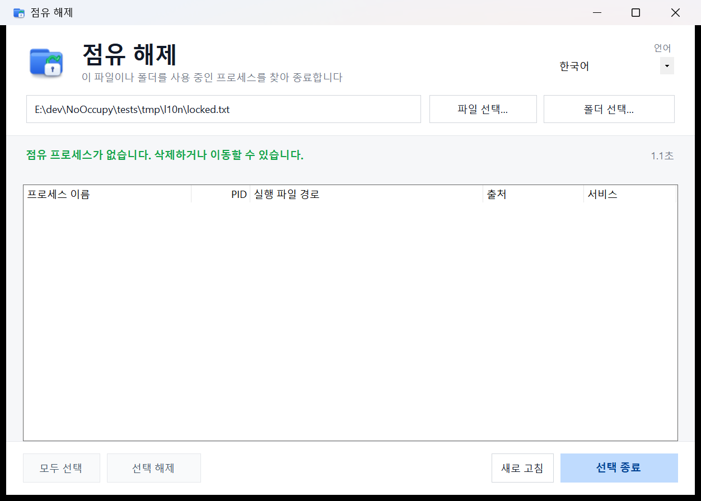

<div align="center">



# NoOccupy

### Find what's locking your files. Get back to work.

**A lightweight Windows utility to find and end processes that prevent files or folders from being deleted, moved, or renamed.**

[](https://github.com/yuan-xin-9997/NoOccupy/releases/latest)
[](#download--installation)
[](#development)
[](#languages)
[](https://github.com/yuan-xin-9997/NoOccupy/releases/latest/download/NoOccupy-Setup.exe)

English | [简体中文](README.cn.md) | [Changelog](CHANGELOG.md)

**[Download](#download--installation) · [Quick Start](#quick-start) · [Features](#features) · [FAQ](#faq) · [Development](#development)**

</div>

## Overview

“The action can't be completed because the file is open in another program.” NoOccupy helps you find that program without searching through Task Manager.

Right-click a file or folder, choose **Release Lock**, review the processes, and end the ones you select. Then retry your delete, move, or rename operation.

## Screenshots

<div align="center">

</div>

<details>
<summary>Installer and other interface languages</summary>

| Installer | 简体中文 |
| :---: | :---: |
|  |  |

| 日本語 | 한국어 |
| :---: | :---: |
|  |  |

</details>

## Features

| Feature | What you get |
| --- | --- |
| Explorer integration | Open from the context menu for files, folders, or a folder background. |
| Multiple detection methods | Combine Windows Restart Manager, NT handle scanning, and module path scanning. |
| Folder scanning | Scan files recursively in batches; skip symbolic links and junctions to avoid loops. |
| Clear process details | Review process names, PIDs, executable paths, detection sources, and services. |
| Selective termination | Select individual processes or all results, then confirm before ending them. Known critical processes are marked and skipped. |
| Four interface languages | Switch the app, installer, and dialogs between English, Chinese, Japanese, and Korean. |
| Small footprint | A single installer of about 234 KB, with no background service or network requests. |
| Automation | Scan and terminate processes through a CLI with JSON output and exit codes. |

## Download & Installation

### Windows

| Download | Description |
| --- | --- |
| **[NoOccupy-Setup.exe](https://github.com/yuan-xin-9997/NoOccupy/releases/latest/download/NoOccupy-Setup.exe)** | Recommended: single-file Windows installer. |
| [All releases](https://github.com/yuan-xin-9997/NoOccupy/releases) | Version history, release notes, and earlier installers. |
| [SHA256SUMS.txt](https://github.com/yuan-xin-9997/NoOccupy/releases/latest/download/SHA256SUMS.txt) | SHA-256 checksum for the latest installer. |

**Requirements:** Windows 10 or Windows 11 (64-bit), .NET Framework 4.8 or later, and administrator permission.

1. Download and run `NoOccupy-Setup.exe`.
2. Allow the Windows administrator prompt.
3. Select your language and install folder. The default is `C:\Program Files\NoOccupy`.
4. Click **Install**. The installer adds Explorer menus, a Start menu shortcut, and a Windows uninstall entry.

A desktop shortcut is optional and disabled by default.

<details>
<summary>Silent installation and checksum verification</summary>

Run installation commands from an elevated PowerShell window:

```powershell
.\NoOccupy-Setup.exe /S
.\NoOccupy-Setup.exe /S /D="D:\Tools\NoOccupy"
```

Compare the following hash with `SHA256SUMS.txt` from the same release:

```powershell
Get-FileHash .\NoOccupy-Setup.exe -Algorithm SHA256
```

</details>

## Quick Start

1. Right-click the locked file or folder and choose **Release Lock**.
2. Review the detected processes and select the ones you want to end.
3. Click **End selected** and confirm.
4. Retry deleting, moving, or renaming the file or folder.

You can also open NoOccupy from the Start menu and use **Choose file…** or **Choose folder…**.

> **Windows 11:** click **Show more options** to find the Explorer menu entry, or press **Shift + F10** to open the classic menu.

> Ending a process can discard its unsaved work. Save your work and review your selection before confirming. Protected processes may remain locked; NoOccupy reports failures.

## Languages

| Language | Explorer menu name | Windows uninstall entry |
| --- | --- | --- |
| English | Release Lock | Release Lock (NoOccupy) |
| 简体中文 | 解除占用 | 解除占用 (NoOccupy) |
| 日本語 | 占有を解除 | 占有を解除 (NoOccupy) |
| 한국어 | 점유 해제 | 점유 해제 (NoOccupy) |

Choose a language at the top of the installer or in the app's upper-right **Language** menu. The interface, dialogs, Explorer menu names, and Windows uninstall entry update immediately. The Start menu shortcut filename stays `NoOccupy.lnk`; its description is written in the selected language during installation.

Your selection is saved in `HKCU\Software\NoOccupy\Language` and shared by the app and installer. On first launch, Chinese, Japanese, and Korean system languages are detected automatically; other system languages use English. CLI output remains Chinese for script compatibility.

## FAQ

### Why isn't the menu visible on Windows 11?

NoOccupy registers a classic Explorer menu. Windows 11 places these entries under **Show more options**. Windows 10 shows the entry directly.

### Why does it request administrator permission?

Detecting handles owned by other processes, ending processes, and registering system-wide Explorer menus require elevated permission. Both the app and installer request it at startup.

### Will every lock be detected or released?

Protected processes, inaccessible handles, and handle-query timeouts can limit detection or termination. NoOccupy reports warnings and errors. Symbolic links and junctions are skipped during recursive scans; open their target directly to scan it.

### Does it run in the background or upload my files?

NoOccupy makes no network requests and installs no background service. It scans when opened and exits when closed. Language preferences are stored in the registry; diagnostic logs may be written to the Windows temporary folder.

### How do I uninstall it?

Use **Windows Settings → Apps → Installed apps**, find the localized name above, and choose **Uninstall**. You can also use Control Panel or run `NoOccupyUninstall.exe` in the install folder.

Silent uninstall from an elevated PowerShell window:

```powershell
& "C:\Program Files\NoOccupy\NoOccupyUninstall.exe" /S /uninstall
```

Uninstall removes the program folder, Explorer menus, Start menu shortcut, and uninstall entry.

## Command Line

Run from an elevated PowerShell window in the installed application folder:

```powershell
.\NoOccupy.exe --scan "C:\path\to\file" --json --out result.json
.\NoOccupy.exe --kill "C:\path\to\file" --all --json
.\NoOccupy.exe --kill "C:\path\to\file" --pid 1234,5678
.\NoOccupy.exe --version
.\NoOccupy.exe --help
```

Exit codes: `0` = success, `1` = invalid arguments or scan/output error, `2` = one or more processes could not be ended. CLI termination proceeds without a GUI confirmation. `--pid` can target a process outside the scan results; verify the PID before running it.

## Development

Build on Windows with the **.NET SDK 8**. The SDK can restore .NET Framework 4.8 reference assemblies from NuGet if the Developer Pack is unavailable.

```powershell
git clone https://github.com/yuan-xin-9997/NoOccupy.git
cd NoOccupy
powershell -NoProfile -ExecutionPolicy Bypass -File .\scripts\build.ps1
powershell -NoProfile -ExecutionPolicy Bypass -File .\scripts\test-release.ps1
```

The build produces `dist/NoOccupy-Setup.exe` and `dist/SHA256SUMS.txt`, and copies the installer to the repository root. The release check verifies assembly versions, embedded payloads, and checksums without installing the app.

<details>
<summary>Project structure</summary>

```text
src/NoOccupy/           WinForms application and CLI
  Core/                Restart Manager, handle/module scanning, process termination
src/NoOccupy.Setup/     Single-file installer with embedded application
src/Shared/            Language preferences and localized dialogs
assets/                Application icons
scripts/               Build and release verification
tests/                 Acceptance scripts, screenshots, and reports
docs/                  Design and release documentation
Directory.Build.props  Shared application and installer version
.github/workflows/     Tag-triggered release automation
```

</details>

To publish a version, update `Directory.Build.props` and the changelog, then push a matching `vX.Y.Z` tag. GitHub Actions builds and verifies the installer and publishes the `.exe` and checksum. See the [release guide](docs/RELEASING.md).

## Contributing

[Report a bug](https://github.com/yuan-xin-9997/NoOccupy/issues) or submit a pull request. Include your Windows version, app version, language, steps to reproduce, and any error message.

For changes to the scanning or installer code, include relevant checks. Existing acceptance reports are in [tests/core-report.md](tests/core-report.md) and [tests/setup-report.md](tests/setup-report.md).

## Acknowledgments

README organization inspired by [CC Switch](https://github.com/farion1231/cc-switch).
